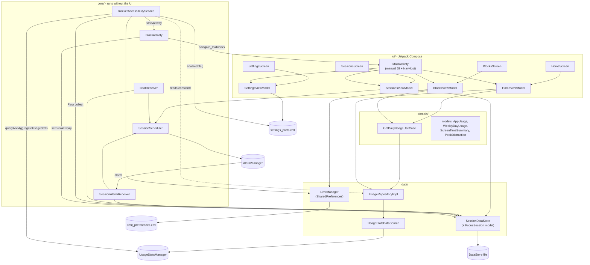
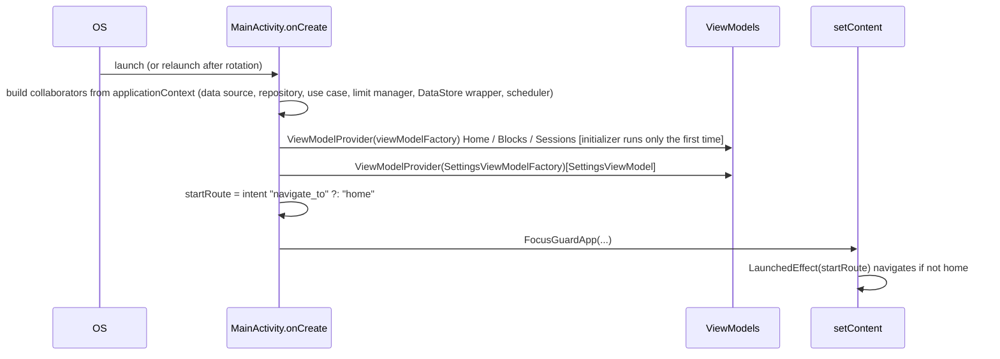
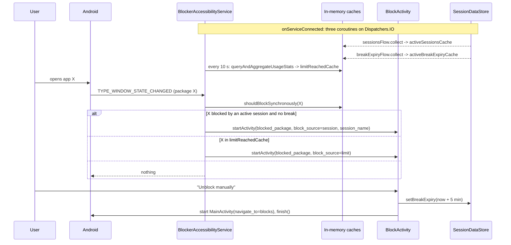
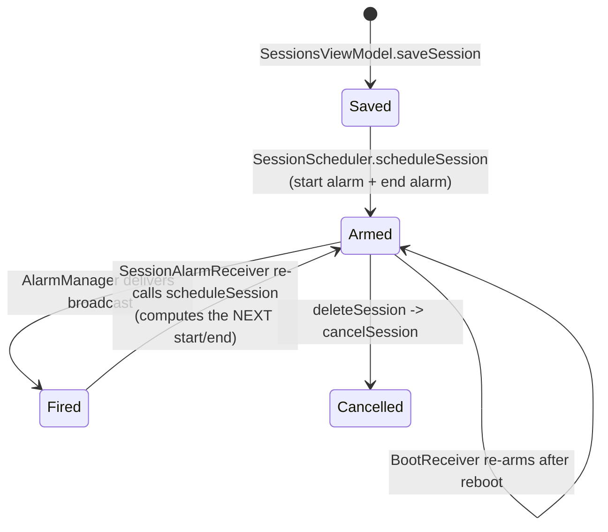
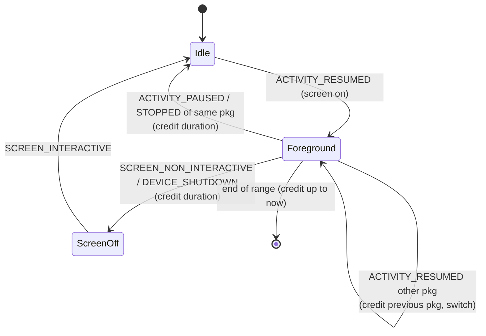

# Architecture

How FocusGuard is actually built, why it is built that way, and where the design is weak.
Evidence tags are explained in the [docs index](README.md#evidence-tags). Each tag below was
checked against the source at commit `6ff1a61` plus the uncommitted working-tree edits
described in the [index](README.md#baseline).

For file-by-file detail see [CODEBASE_WALKTHROUGH.md](CODEBASE_WALKTHROUGH.md); for the
platform concepts (AccessibilityService, DataStore, coroutines...) see
[ANDROID_CONCEPTS.md](ANDROID_CONCEPTS.md); defects are tracked only in
[BUGS_AND_TECHNICAL_DEBT.md](BUGS_AND_TECHNICAL_DEBT.md).

---

## 1. What the system does

FocusGuard is a single-module, single-process Android app (`applicationId = com.focusguard`,
`minSdk 21`, `targetSdk 34`, `compileSdk 36`) with two jobs **[O]**:

1. **Measure** screen time per app from the system usage-event log.
2. **Enforce** two kinds of blocking by covering the blocked app with `BlockActivity`:
   - *Session blocks* - during a user-defined time window, a chosen set of apps is blocked.
   - *Limit blocks* - once an app's time today reaches a per-app daily limit, it is blocked.

There is no backend, no network permission, no account system and no Room database **[O]**
(manifest declares no `INTERNET`).

## 2. Structure as built

What the picture shows that the usual "clean architecture" diagram would hide:

- **`core/` bypasses the layers.** The accessibility service talks straight to
  `SessionDataStore`, `LimitManager` and `UsageStatsManager`, and reads static sets from
  `UsageRepositoryImpl`'s companion object **[O]**.
- **`domain/` is thin and leaky.** It holds `rules/SessionRules.kt` (the shared "is this session active?" rule, see section 6). The only use case (`GetDailyUsageUseCase`) wraps one call and
  depends on the concrete `UsageRepositoryImpl` (there is no repository interface), and
  `HomeViewModel` calls the repository directly for weekly data **[O]**.
- **`FocusSession`, the core business model, lives in `data/local/SessionDataStore.kt`**, not in
  `domain/model` **[O]**.
- **No dependency injection framework.** `MainActivity.onCreate` constructs everything by hand
  (see [section 5](#5-startup-and-object-wiring)).

None of this stops the app from working; it affects testability and is logged as technical debt
([BUGS B-014](BUGS_AND_TECHNICAL_DEBT.md#b-014)).

## 3. Runtime entry points

All components share one process and one `Application` (no custom `Application` class) **[O]**.

| Entry point | Declared in manifest | Triggered by | Role |
|---|---|---|---|
| `MainActivity` | launcher, exported | user / `BlockActivity` | Compose UI host |
| `BlockerAccessibilityService` | exported, `BIND_ACCESSIBILITY_SERVICE` | system, once user enables it | **the enforcement engine** |
| `BlockActivity` | not exported, `noHistory`, `excludeFromRecents` | the service | block screen |
| `SessionAlarmReceiver` | not exported | `AlarmManager` | re-arms the next alarm |
| `BootReceiver` | exported, `BOOT_COMPLETED` / `QUICKBOOT_POWERON` | boot | re-arms alarms, notifies if service off |

## 4. Persistence

| Data | Store | Format | Writers | Readers |
|---|---|---|---|---|
| Focus sessions | Preferences DataStore `focus_sessions_datastore`, key `sessions_json_v2` | JSON array in one string | `SessionsViewModel` | `SessionsViewModel`, service, both receivers |
| Active break expiry | same DataStore, key `active_break_expiry_millis` | epoch ms `Long` | `BlockActivity` (set), `SessionsViewModel` (clear) | service, `SessionsViewModel` |
| Per-app daily limits | SharedPreferences `limit_preferences` | package -> ms `Long` | `BlocksViewModel` | `BlocksViewModel`, service |
| Theme + "blocking enabled" | SharedPreferences `settings_prefs` | strings / boolean | `SettingsViewModel` | `SettingsViewModel` only |

Two storage technologies are used for the same kind of data (small key-value state). Only the
DataStore ones are observable as a `Flow`; the service therefore has to *poll* limits but can
*subscribe* to sessions. The `blocking_enabled` switch is shared through `data/local/BlockingPreference`:
`SettingsViewModel` writes it and `BlockerAccessibilityService` checks it before evaluating anything
([B-003](BUGS_AND_TECHNICAL_DEBT.md#b-003), fixed).

## 5. Startup and object wiring

All four ViewModels are obtained through the Activity's `ViewModelStore`, so they survive
rotation and their `viewModelScope` is cancelled only when the Activity finishes for good.
Because they now outlive the Activity, **every collaborator is built from `applicationContext`**
(a ViewModel must never reach an Activity through the repository or scheduler).
Before this was fixed, three ViewModels were built with plain constructors, never entered the
store, and leaked one Activity per rotation ([B-002](BUGS_AND_TECHNICAL_DEBT.md#b-002), measured
on an emulator: 9 live Activities after 12 rotations vs 1 after the fix; also
[B-009](BUGS_AND_TECHNICAL_DEBT.md#b-009)).

Navigation: a `NavHost` with routes `home`, `blocks`, `sessions`, `settings`, `privacy`.
The Sessions tab has its own *internal* navigation (`SessionNav` sealed class held in a
`remember`), not the NavController.

## 6. The blocking pipeline (the heart of the app)

Key properties **[O]**:

- The decision is made in `onAccessibilityEvent` on the **main thread** using only `@Volatile`
  in-memory values: no disk or IPC on the hot path. That is the "zero-latency" claim, and it is
  structurally true.
- Enforcement is **clock-driven**: `shouldBlockSynchronously` recomputes "is this session active
  right now?" from `LocalDateTime.now()` on every event. The alarms are *not* what starts or
  stops a block ([section 7](#7-the-alarm-subsystem-and-what-it-really-does)).
- A **break** (`activeBreakExpiryCache`) only suppresses *session* blocks. The limit branch never
  consults it ([B-005](BUGS_AND_TECHNICAL_DEBT.md#b-005)).
- Limits are enforced from a 10-second poll, so a limit can be exceeded by up to ~10 s plus the
  next window-change event **[I]**.
- Block exemptions are a static list: own package, `NEVER_BLOCKABLE` (dialer/SMS/contacts) and
  `ALWAYS_HIDDEN` (launchers, keyboards, Settings, GMS...) **[O]**.

### The "is a session active" rule

| Place | File | Used for |
|---|---|---|
| `FocusSession.remainingMillisAt(now)` | `domain/rules/SessionRules.kt` | **the one rule**: returns ms left, or `null` when inactive |
| called by `shouldBlockSynchronously` | `core/services/BlockerAccessibilityService.kt` | enforcement |
| called by `evaluateActiveSession` | `ui/sessions/SessionsViewModel.kt` | "Active session" card + countdown |
| `calculateNextTrigger` (different shape, still separate) | `core/scheduling/SessionScheduler.kt` | alarm times |

The rule is pinned by `SessionRulesTest` (including its midnight-crossing limitation,
[B-004](BUGS_AND_TECHNICAL_DEBT.md#b-004)). The scheduler's separate date math is not yet covered.

## 7. The alarm subsystem and what it really does

**[O]** `SessionAlarmReceiver.onReceive` loads the session and calls `scheduleSession` again.
It never starts or stops anything, and it ignores `EXTRA_IS_START`. **[I]** The only observable
effects are (a) the alarm keeps a perpetual chain of "next occurrence" alarms alive and (b) the
device/process is woken at the boundaries. The README's description of AlarmManager as what
"triggers sessions" is therefore inaccurate; it is kept by the clock-driven check instead.
This is not a bug, but it is dead-weight complexity and worth knowing for interviews
([B-012](BUGS_AND_TECHNICAL_DEBT.md#b-012)).

## 8. Usage measurement

`UsageStatsDataSource.getSotByPackage(start, end)` replays raw `UsageEvents` and tracks **one**
foreground package at a time:

This is why the Home screen can differ from `totalTimeInForeground` (which can double-count
overlapping activities). But **limit enforcement does not use this algorithm** - it uses
`queryAndAggregateUsageStats().totalTimeInForeground` ([B-006](BUGS_AND_TECHNICAL_DEBT.md#b-006)).
The Home number and the number that triggers a block can therefore disagree.

Filtering (`UsageRepositoryImpl.getHiddenPackages`, cached forever in a field) removes: a static
`ALWAYS_HIDDEN` list, all `CATEGORY_HOME` launchers, system apps without a launcher icon, and
input-method packages, plus the app itself and `com.android.server*`.

## 9. Design decisions and trade-offs

| Decision (observed) | Why it was probably chosen **[I]** | Cost / alternative |
|---|---|---|
| `AccessibilityService` for foreground detection | Event-driven, no foreground service or polling needed to notice app switches | Needs a scary user-granted permission; killed by some OEMs; Play-policy scrutiny. Alternative: foreground service polling `UsageEvents` (battery, notification) |
| Clock-driven enforcement + in-memory caches | Zero-latency, survives alarm failures, no state machine to corrupt | Rules duplicated in several places; every event does date math |
| Sessions as one JSON string in DataStore | No schema/migration work, simple `Flow` | Whole-list rewrite on every save, no partial updates, silent data loss on parse errors; Room would give queries and migrations |
| Manual DI in `MainActivity` | Tiny app, no framework overhead | Must be done carefully (application context + `ViewModelProvider`, see section 5); the service and receivers have their own second wiring; Hilt would centralise it |
| Custom event-stream usage algorithm | Matches Digital Wellbeing better than `totalTimeInForeground` (see commit `8457d3f`) | Two algorithms in the codebase; untested |
| Compose + single-activity + bottom nav | Modern default, little boilerplate | Sessions' internal nav is not saved across recreation |
| `BlockActivity` written with XML views | Quick overlay, no Compose startup cost in a hot path **[I]** | Third UI style in the app (XML + Compose + hard-coded colors) |

## 10. Known architectural weaknesses (summary)

See the bug list for IDs and evidence: thin test coverage ([B-013](BUGS_AND_TECHNICAL_DEBT.md#b-013)), the
scheduler's separate date math and the midnight limitation ([B-004](BUGS_AND_TECHNICAL_DEBT.md#b-004)), two usage algorithms
([B-006](BUGS_AND_TECHNICAL_DEBT.md#b-006)), `java.time` on `minSdk 21` without desugaring
([B-001](BUGS_AND_TECHNICAL_DEBT.md#b-001)).
